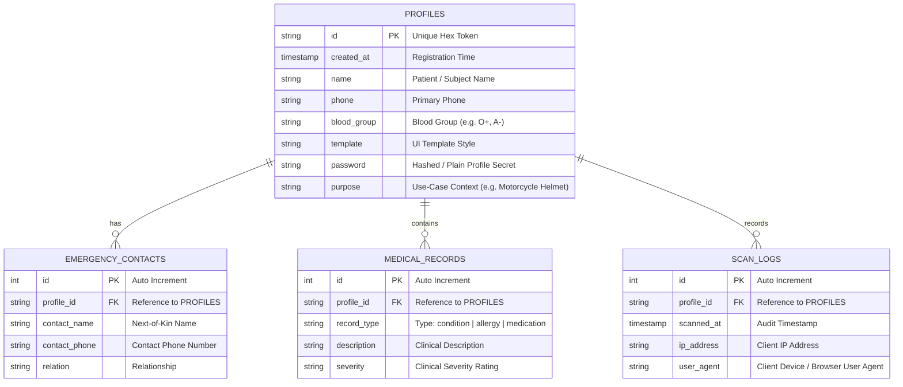

# 🚨 SAVE-ME: Emergency Response & Medical Analytics Platform

[](https://www.python.org/)
[](https://flask.palletsprojects.com/)
[](https://scikit-learn.org/)
[](https://sqlite.org/)
[](https://tailwindcss.com/)
[](https://www.chartjs.org/)

**SAVE-ME** is an end-to-end, data-driven emergency medical response and analytics platform. By combining dynamic QR/NFC technology with a **Normalized Relational Architecture** and an integrated **Machine Learning Triage Scoring Engine**, SAVE-ME bridges the critical information gap during vehicular accidents and medical emergencies while delivering actionable population health and incident intelligence.

---

## 🌟 Core Highlights & Capabilities

- ⚡ **Instant-Response QR & NFC Profiles**: Instantly generates downloadable, high-resolution QR codes linking directly to a patient's vital medical profile—no app installation required for first responders.
- 🧠 **Predictive Patient Vulnerability Scoring (AI/ML)**: Embedded Machine Learning (`RandomForestClassifier`) paired with a heuristic safety engine that evaluates baseline trauma risk (e.g., motorcycle helmet vs. general ID), chronic conditions, critical medications, high-risk allergies (penicillin, peanuts, latex), and contact availability to categorize patients into **High, Medium, or Low Risk**.
- 📊 **Executive BI & Analytics Dashboard**: Built-in analytics console powered by Chart.js presenting real-time risk stratification distributions, emergency scan velocity trends, and use-case breakdown.
- 🔐 **Zero-Friction Access with Tiered Privacy**: Publicly presents life-saving data (blood group, emergency contacts, critical conditions) while gating sensitive edit capabilities behind password verification.
- 🛡️ **Comprehensive Audit Trail**: Automatically captures every profile scan with timestamp, IP address, and client user-agent for forensic accountability and incident tracking.
- 🧪 **One-Click Live Data Seeder**: Built-in mock data generator (`/admin/seed`) allowing instantaneous population of realistic profiles, scan histories, and conditions for demonstration.

---

## 🏗️ System & Database Architecture

SAVE-ME utilizes a **Third Normal Form (3NF) Relational SQLite Schema** ensuring referential integrity, modularity, and rapid query execution:



---

## 🗂️ Project Structure

```plaintext
SAVE-ME/
├── backend/
│   ├── app.py               # Main Flask API, routing, and controller logic
│   ├── database.py          # SQLite schema design, connection, & initialization
│   ├── ml_risk_scorer.py    # Random Forest triage risk modeling & heuristic engine
│   └── requirements.txt     # Python dependency manifest
├── frontend/
│   ├── index.html           # Modern landing page & feature overview
│   ├── profile_form.html    # Profile generation wizard with consent controls
│   ├── profile_view.html    # Emergency responder view with dynamic risk badge
│   ├── qr_display.html      # QR download & print preview interface
│   ├── scanner.html         # In-browser QR code scanner for first responders
│   ├── edit_profile.html    # Authenticated record update portal
│   ├── admin.html           # Executive BI analytics dashboard (Chart.js)
│   ├── admin_login.html     # Administrative authentication portal
│   └── style.css            # Custom UI stylesheet
├── run.bat                  # One-click Windows batch launcher
├── run.ps1                  # PowerShell execution script
└── README.md                # Project documentation
```

---

## 🚀 Quick Start & Installation

### Prerequisites
- **Python 3.10+**
- Git

### 1. Clone the Repository
```bash
git clone https://github.com/tdheeraj28/SAVE-ME.git
cd SAVE-ME
```

### 2. Set Up Virtual Environment

**Windows:**
```powershell
python -m venv venv
.\venv\Scripts\activate
```

**macOS / Linux:**
```bash
python3 -m venv venv
source venv/bin/activate
```

### 3. Install Dependencies
```bash
pip install -r backend/requirements.txt
```

### 4. Run the Application

**Quick Launcher (Windows):**
Simply double-click `run.bat` or run:
```powershell
.\run.ps1
```

**Manual Launch:**
```bash
cd backend
python app.py
```

The application will be live at **[http://127.0.0.1:5000](http://127.0.0.1:5000)**.

---

## 🧭 Navigation & Endpoint Directory

| Route | Description | Method | Authentication |
| :--- | :--- | :---: | :---: |
| `/` | Landing page showcasing platform features | `GET` | Public |
| `/select_template/template1` | Registration wizard to generate a new QR profile | `GET` | Public |
| `/profile/<profile_id>` | Responders' vital medical view with triage risk badge | `GET` | Public |
| `/scanner` | In-browser camera scanner to scan QR codes | `GET` | Public |
| `/edit_profile/<profile_id>` | Secure portal to modify emergency and clinical info | `GET`, `POST` | Profile Password |
| `/admin` | Executive Business Intelligence & Analytics dashboard | `GET`, `POST` | Admin Password: `ait` |
| `/admin/seed` | Simulates and seeds 50 sample profiles & scan logs | `GET` | Admin / Developer |

---

## 🤖 Predictive Risk Modeling Details

The risk scoring pipeline in [`ml_risk_scorer.py`](backend/ml_risk_scorer.py) utilizes a composite approach:
1. **Context Factor**: Baseline vulnerability derived from the purpose (e.g. *Motorcycle Helmet* users receive higher trauma risk weighting than *General Identification*).
2. **Medical Complexity**: Calculated based on the density of chronic conditions and active prescription medications.
3. **Severe Allergy Detection**: Text parser flags life-threatening allergens (`penicillin`, `peanut`, `latex`, `bee`).
4. **Safety Net**: Scored penalty if no emergency contact is designated.
5. **Machine Learning Model**: Uses a `RandomForestClassifier` trained on multi-feature synthetic distributions to output a triage status (**High Risk**, **Medium Risk**, **Low Risk**).

---

## 📄 License
This project is open-source under the MIT License.
